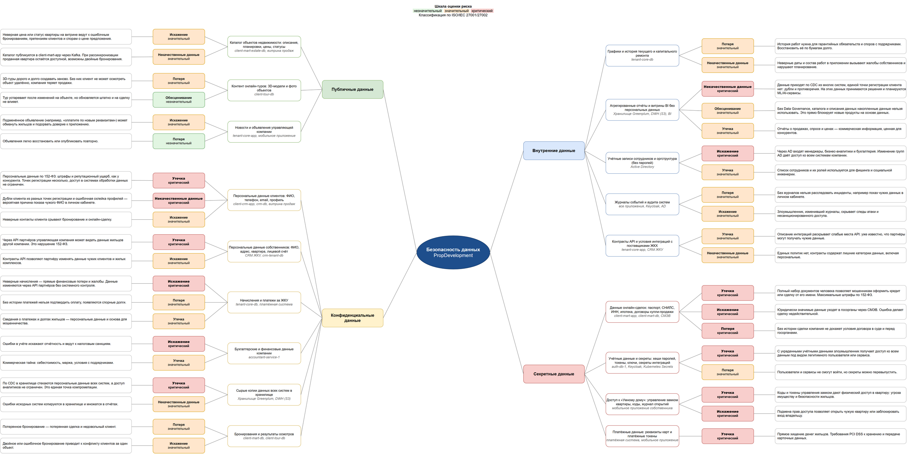

# Задание 1. Классификация данных и риски

Mindmap: [data-security-mindmap.drawio](data-security-mindmap.drawio). Открывается в [draw.io](https://app.diagrams.net/) или в настольном приложении.

Категории по ISO/IEC 27001/27002: публичные, внутренние, конфиденциальные, секретные. Секретные здесь — данные с наибольшим ущербом при компрометации (не государственная тайна): документы сделок, учётные данные и секреты, доступ к жилью, платёжные данные.

Шкала оценки: незначительный, значительный, критический.

## Публичные данные

| Данные | Где хранятся | Риск | Оценка | Обоснование |
| --- | --- | --- | --- | --- |
| Каталог объектов недвижимости: описания, планировки, цены, статусы | client-mart-estate-db, витрина продаж | Искажение | значительный | Неверная цена или статус квартиры на витрине ведут к ошибочным бронированиям, претензиям клиентов и спорам о цене предложения. |
|  |  | Некачественные данные | значительный | Каталог публикуется в client-mart-app через Kafka. При рассинхронизации проданная квартира остаётся доступной, возможны двойные бронирования. |
| Контент онлайн-туров: 3D-модели и фото объектов | client-tour-db | Потеря | значительный | 3D-туры дорого и долго создавать заново. Без них клиент не может осмотреть объект удалённо, компания теряет продажи. |
|  |  | Обесценивание | незначительный | Тур устаревает после изменений на объекте, но обновляется штатно и на сделку не влияет. |
| Новости и объявления управляющей компании | tenant-core-app, мобильное приложение | Искажение | значительный | Подменённое объявление (например, «оплатите по новым реквизитам») может обмануть жильцов и подорвать доверие к приложению. |
|  |  | Потеря | незначительный | Объявления легко восстановить или опубликовать повторно. |

## Внутренние данные

| Данные | Где хранятся | Риск | Оценка | Обоснование |
| --- | --- | --- | --- | --- |
| Графики и история текущего и капитального ремонта | tenant-core-db | Потеря | значительный | История работ нужна для гарантийных обязательств и споров с подрядчиками. Восстановить её по бумагам долго. |
|  |  | Некачественные данные | значительный | Неверные даты и состав работ в приложении вызывают жалобы собственников и нарушают планирование. |
| Агрегированные отчёты и витрины BI без персональных данных | Хранилище Greenplum, DWH (S3), BI | Некачественные данные | критический | Данные приходят по CDC из многих систем, единой точки регистрации клиента нет: дубли и противоречия. На этих данных принимаются решения и планируются ML/AI-сервисы. |
|  |  | Обесценивание | значительный | Без Data Governance, каталога и описания данных накопленные данные нельзя использовать. Это прямо блокирует новые продукты на основе данных. |
|  |  | Утечка | значительный | Отчёты о продажах, спросе и ценах — коммерческая информация, ценная для конкурентов. |
| Учётные записи сотрудников и оргструктура (без паролей) | Active Directory | Искажение | критический | Через AD входят менеджеры, бизнес-аналитики и бухгалтерия. Изменение групп AD даёт доступ ко всем системам компании. |
|  |  | Утечка | значительный | Список сотрудников и их ролей используется для фишинга и социальной инженерии. |
| Журналы событий и аудита систем | все приложения, Keycloak, AD | Потеря | значительный | Без журналов нельзя расследовать инциденты, например показ чужих данных в личном кабинете. |
|  |  | Искажение | значительный | Злоумышленник, изменивший журналы, скрывает следы атаки и несанкционированного доступа. |
| Контракты API и условия интеграций с поставщиками ЖКХ | tenant-core-app, CRM ЖКУ | Утечка | значительный | Описание интеграций раскрывает слабые места API: уже известно, что партнёры могут получать чужие данные. |
|  |  | Некачественные данные | значительный | Единых политик нет, контракты содержат лишние категории данных, включая персональные. |

## Конфиденциальные данные

| Данные | Где хранятся | Риск | Оценка | Обоснование |
| --- | --- | --- | --- | --- |
| Персональные данные клиентов: ФИО, телефон, email, профиль | client-crm-app, crm-db, витрина продаж | Утечка | критический | Персональные данные по 152-ФЗ: штрафы и репутационный ущерб, как у конкурента. Точек регистрации несколько, доступ в системах обработки данных не ограничен. |
|  |  | Некачественные данные | критический | Дубли клиента из разных точек регистрации и ошибочная склейка профилей — вероятная причина показа чужого ФИО в личном кабинете. |
|  |  | Искажение | значительный | Неверные контакты клиента срывают бронирование и онлайн-сделку. |
| Персональные данные собственников: ФИО, адрес, квартира, лицевой счёт | CRM ЖКУ, crm-tenant-db | Утечка | критический | Через API партнёров управляющая компания может видеть данные жильцов другой компании. Это нарушение 152-ФЗ. |
|  |  | Искажение | значительный | Контракты API позволяют партнёру изменять данные чужих клиентов и жилых комплексов. |
| Начисления и платежи за ЖКУ | tenant-core-db, платёжная система | Искажение | критический | Неверные начисления — прямые финансовые потери и жалобы. Данные изменяются через API партнёров без системного контроля. |
|  |  | Потеря | значительный | Без истории платежей нельзя подтвердить оплату, появляются спорные долги. |
|  |  | Утечка | значительный | Сведения о платежах и долгах жильцов — персональные данные и основа для мошенничества. |
| Бухгалтерские и финансовые данные компании | accountant-service-1 | Искажение | критический | Ошибки в учёте искажают отчётность и ведут к налоговым санкциям. |
|  |  | Утечка | значительный | Коммерческая тайна: себестоимость, маржа, условия с подрядчиками. |
| Сырые копии данных всех систем в хранилище | Хранилище Greenplum, DWH (S3) | Утечка | критический | По CDC в хранилище стекаются персональные данные всех систем, а доступ аналитиков не ограничен. Это единая точка компрометации. |
|  |  | Некачественные данные | значительный | Ошибки исходных систем копируются в хранилище и множатся в отчётах. |
| Бронирования и результаты осмотров | client-mart-db, client-tour-db | Потеря | значительный | Потерянное бронирование — потерянная сделка и недовольный клиент. |
|  |  | Искажение | значительный | Двойное или ошибочное бронирование приводит к конфликту клиентов за один объект. |

## Секретные данные

| Данные | Где хранятся | Риск | Оценка | Обоснование |
| --- | --- | --- | --- | --- |
| Данные онлайн-сделок: паспорт, СНИЛС, ИНН, ипотека, договоры купли-продажи | client-mart-app, client-mart-db, СМЭВ | Утечка | критический | Полный набор документов человека позволяет мошенникам оформить кредит или сделку от его имени. Максимальные штрафы по 152-ФЗ. |
|  |  | Искажение | критический | Юридически значимые данные уходят в госорганы через СМЭВ. Ошибка делает сделку недействительной. |
|  |  | Потеря | критический | Без истории сделки компания не докажет условия договора в суде и перед госорганами. |
| Учётные данные и секреты: хеши паролей, токены, ключи, секреты интеграций | auth-db-1, Keycloak, Kubernetes Secrets | Утечка | критический | С украденными учётными данными злоумышленник получает доступ ко всем данным под видом легитимного пользователя или сервиса. |
|  |  | Потеря | значительный | Пользователи и сервисы не смогут войти, но секреты можно перевыпустить. |
| Доступ к «Умному дому»: управление замком квартиры, коды, журнал открытий | мобильное приложение собственника | Утечка | критический | Коды и токены управления замком дают физический доступ в квартиру: угроза имуществу и безопасности жильцов. |
|  |  | Искажение | критический | Подмена прав доступа позволяет открыть чужую квартиру или заблокировать вход владельцу. |
| Платёжные данные: реквизиты карт и платёжные токены | платёжная система, мобильное приложение | Утечка | критический | Прямое хищение денег жильцов. Требования PCI DSS к хранению и передаче карточных данных. |
