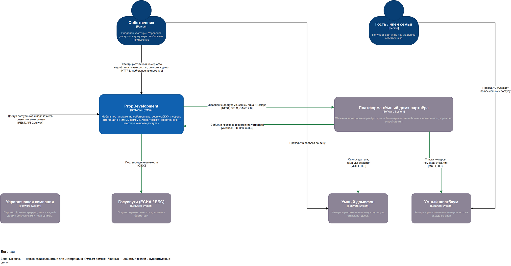
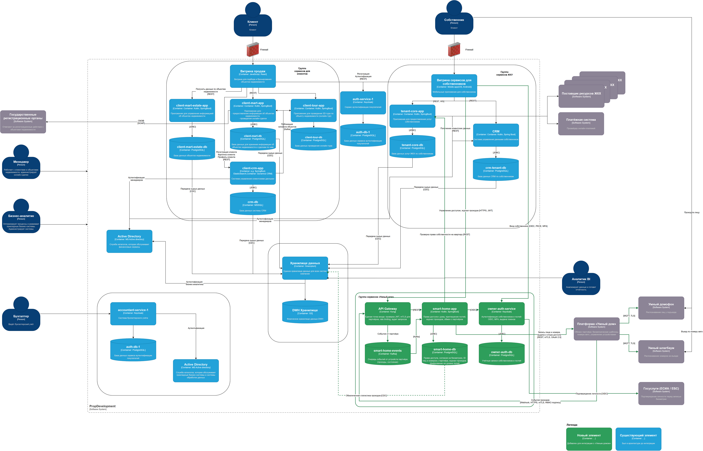

# Задание 3. Интеграция с партнёром «Умный дом»

Партнёр предоставляет два устройства, которыми собственник управляет через мобильное приложение PropDevelopment:

- **умный домофон** — открывает дверь подъезда по распознаванию лица;
- **умный шлагбаум** — открывает въезд во двор по распознаванию номера автомобиля.

Устройства подключены к облачной платформе партнёра. PropDevelopment не управляет устройствами напрямую: компания хранит, кто и к какому дому имеет доступ, и передаёт эти права партнёру через API.

## 1. Диаграмма контекста

Файл: [smart-home-context.drawio](smart-home-context.drawio)

| Участник | Роль в интеграции |
|---|---|
| Собственник | Регистрирует своё лицо и номер авто, приглашает гостей, выдаёт и отзывает доступ, смотрит журнал проходов |
| Гость / член семьи | Проходит и въезжает по доступу, который выдал собственник. Доступ временный или постоянный |
| PropDevelopment | Мастер-система прав доступа: знает, кто владеет квартирой и кому собственник разрешил вход |
| Платформа «Умный дом» | Хранит биометрические шаблоны и номера авто, распознаёт их и управляет устройствами |
| Умный домофон, умный шлагбаум | Устройства на объекте, работают по спискам доступа от платформы партнёра |
| Управляющая компания | Выдаёт доступ сотрудникам и подрядчикам, но только по домам, которые она обслуживает |
| Госуслуги (ЕСИА / ЕБС) | Подтверждают личность перед записью биометрии, чтобы лицо не зарегистрировал посторонний человек |

## 2. Обновлённая диаграмма контейнеров

Файл: [smart-home-containers.drawio](smart-home-containers.drawio). Новые элементы выделены зелёным.

### Новые контейнеры

| Контейнер | Технология | Назначение |
|---|---|---|
| API Gateway | Kong | Единая точка входа для мобильного приложения и партнёра. Проверяет JWT, принимает webhook партнёра только по mTLS, ограничивает частоту запросов, пишет журнал запросов |
| smart-home-app | Kotlin, Spring Boot | Права доступа к дому, приглашения гостей, журнал проходов, обмен с платформой партнёра |
| smart-home-db | PostgreSQL | Права доступа, согласия на обработку биометрии, идентификаторы лица и номера у партнёра, журнал проходов |
| smart-home-events | Kafka | Очередь событий от партнёра: проходы, состояние устройств. Если smart-home-app недоступен, события не теряются |
| owner-auth-service | Keycloak | Отдельный провайдер учётных записей собственников и гостей: OIDC, MFA, выдача токенов. Не смешивается с auth-service-1 покупателей |
| owner-auth-db | PostgreSQL | Учётные записи собственников и гостей |

### Изменения существующих элементов

- **Мобильное приложение собственника** ходит в новые сервисы через API Gateway и получает токен в owner-auth-service.
- **tenant-core-app** отвечает smart-home-app, владеет ли пользователь квартирой в этом доме.
- **Хранилище данных** получает из smart-home-db только обезличенную статистику проходов. Биометрия, номера авто и ФИО туда не попадают.

### Основные сценарии

**Регистрация лица собственника**
1. Собственник входит в приложение через owner-auth-service: OIDC и второй фактор.
2. Подтверждает личность через Госуслуги и даёт согласие на обработку биометрии.
3. Приложение снимает фото и отправляет его через API Gateway в smart-home-app.
4. smart-home-app проверяет в tenant-core-app, что пользователь — собственник квартиры в этом доме.
5. smart-home-app передаёт фото партнёру по mTLS. Партнёр строит биометрический шаблон и возвращает его идентификатор.
6. В smart-home-db сохраняется только этот идентификатор и факт согласия. Фото у PropDevelopment не остаётся.

**Проход через домофон**
1. Домофон распознаёт лицо и открывает дверь. Решение принимает партнёр по актуальному списку доступа, поэтому проход работает даже при недоступности PropDevelopment.
2. Партнёр отправляет событие прохода webhook-ом в API Gateway.
3. API Gateway кладёт событие в Kafka.
4. smart-home-app сохраняет событие в журнал и показывает его собственнику.

**Гостевой доступ**
1. Собственник выбирает гостя, тип доступа (лицо или номер авто) и срок действия.
2. smart-home-app передаёт партнёру доступ с датой окончания.
3. По истечении срока партнёр сам удаляет доступ. smart-home-app дополнительно сверяет списки раз в сутки.

**Отзыв доступа при продаже квартиры**
1. smart-home-app получает из tenant-core-app список квартир, где сменился собственник.
2. smart-home-app отзывает у партнёра все доступы прежнего собственника и его гостей.

## 3. Требования

### 3.1. Требования безопасности

**Биометрия и персональные данные**

1. Изображение лица — биометрические персональные данные (ст. 11 152-ФЗ). Обрабатывать их можно только с отдельного письменного (электронного) согласия субъекта. Согласие и его отзыв хранятся в smart-home-db с датой и версией текста.
2. PropDevelopment не хранит фото и биометрические шаблоны. Фото передаётся партнёру один раз и удаляется из памяти сервиса. В своей базе остаётся только идентификатор шаблона у партнёра.
3. Перед записью биометрии личность подтверждается через Госуслуги. Это не даёт зарегистрировать чужое лицо на квартиру.
4. Номер автомобиля, привязанный к ФИО и адресу, — персональные данные. Он хранится в smart-home-db в зашифрованном виде.
5. При отзыве согласия или смене собственника данные удаляются у партнёра и в smart-home-db не позднее чем за 30 дней. Факт удаления фиксируется в журнале.
6. В хранилище данных (DWH) передаётся только обезличенная статистика: дом, время, тип устройства, без идентификаторов людей.

**Требования к партнёру**

7. Договор поручения обработки ПДн (ч. 3 ст. 6 152-ФЗ). В нём перечислены цели, сроки хранения, меры защиты и обязанность сообщать об инцидентах в течение 24 часов.
8. Данные хранятся и обрабатываются на территории РФ (ч. 5 ст. 18 152-ФЗ).
9. Биометрические шаблоны у партнёра зашифрованы, доступ к ним журналируется.
10. Устройства распознают «живое» лицо, а не фото или экран (liveness detection).
11. Связь между устройствами и платформой партнёра шифруется (MQTT поверх TLS), у каждого устройства свой сертификат.

**Шифрование и хранение**

12. Все соединения — TLS 1.2 и выше. Соединения между PropDevelopment и партнёром — mTLS: обе стороны проверяют сертификаты друг друга.
13. Персональные поля в smart-home-db (номер авто, телефон гостя) шифруются на уровне полей. Ключи хранятся в хранилище секретов, а не в коде и не в конфигурации.
14. Секреты для доступа к API партнёра (client secret, закрытый ключ сертификата) хранятся в хранилище секретов и ротируются не реже раза в 90 дней.

**Разграничение доступа**

15. Собственник видит и меняет доступы только своих квартир. Принадлежность проверяется в tenant-core-app при каждой операции, а не только при входе.
16. Гость не может выдавать доступ другим людям.
17. Управляющая компания видит только дома, которые обслуживает, и только доступы своих сотрудников и подрядчиков. Биометрию жильцов она не видит. Это закрывает текущую проблему, когда партнёры видят данные чужих клиентов.
18. Партнёр получает только данные, нужные для открытия: идентификатор доступа, дом и подъезд, срок действия. ФИО, телефон и номер квартиры не передаются.

**Мониторинг и аудит**

19. Каждая операция с доступом (выдача, отзыв, регистрация лица) пишется в журнал аудита: кто, когда, кому, с какого устройства. Журнал хранится не меньше 3 лет.
20. События безопасности (ошибки аутентификации, отклонённые webhook, массовые выдачи доступа) отправляются в SIEM. Ответственный за ИБ получает по ним уведомления.
21. Перед запуском проводится тестирование на проникновение API Gateway и API интеграции.

### 3.2. Протоколы аутентификации и авторизации

| Кто → куда | Протокол | Как работает |
|---|---|---|
| Собственник / гость → мобильное приложение | OpenID Connect, Authorization Code + PKCE | Приложение открывает страницу входа owner-auth-service и получает код, затем меняет его на токены. PKCE не даёт перехватить код на телефоне. Пароль приложение не видит |
| Вход собственника | MFA: пароль + одноразовый код (SMS или приложение-аутентификатор) | Обязательно для регистрации биометрии и выдачи доступа. Для просмотра журнала достаточно сессии |
| Мобильное приложение → API Gateway → smart-home-app | OAuth 2.0 Bearer, JWT | Access token живёт 5–15 минут, refresh token — до 30 дней, с ротацией. API Gateway проверяет подпись по ключам owner-auth-service (JWKS) |
| Права внутри smart-home-app | RBAC + проверка владения | Роли в токене: owner, guest, uk_operator. Право на конкретный дом проверяется по данным tenant-core-app (ABAC: атрибуты «дом», «квартира») |
| smart-home-app → платформа партнёра | mTLS + OAuth 2.0 Client Credentials | Сервис получает у партнёра токен с минимальными scope: `access:write`, `access:read`. Без нашего клиентского сертификата соединение не установится |
| Платформа партнёра → API Gateway (webhook) | mTLS + HMAC-подпись тела + метка времени | Шлюз принимает запрос только с сертификатом партнёра. Подпись защищает от подмены, метка времени — от повторной отправки старого события |
| Сотрудник управляющей компании → API Gateway | OIDC через owner-auth-service (отдельный realm для УК) + MFA | Токен содержит список обслуживаемых домов. Шлюз и smart-home-app отклоняют запросы по другим домам |
| owner-auth-service → Госуслуги | OIDC (ЕСИА) | Подтверждение личности перед записью биометрии |

### 3.3. Организация взаимодействия

**API и контракты**

1. Взаимодействие с партнёром описывается контрактом OpenAPI. Контракт версионируется (`/v1/...`), изменения согласуются обеими сторонами заранее.
2. Синхронные команды (выдать доступ, отозвать, зарегистрировать лицо) — REST поверх HTTPS. Повторный запрос с тем же `Idempotency-Key` не создаёт дубль доступа.
3. События от партнёра (проход, отказ, состояние устройства) — асинхронно, webhook → API Gateway → Kafka. Партнёр повторяет отправку, пока не получит ответ 2xx, поэтому smart-home-app отбрасывает дубли по идентификатору события.

**Надёжность**

4. Открытие двери не зависит от доступности PropDevelopment: решение принимает партнёр по последнему полученному списку доступа.
5. При недоступности API партнёра команды на выдачу и отзыв сохраняются в smart-home-db и отправляются повторно (паттерн outbox). Отзыв доступа имеет приоритет.
6. Раз в сутки smart-home-app сверяет списки доступа со стороной партнёра и исправляет расхождения.
7. Для вызовов партнёра используются таймауты, повторы с увеличивающейся паузой и circuit breaker, чтобы сбой партнёра не повлиял на остальные сервисы ЖКУ.
8. SLA партнёра закрепляется в договоре: доступность API не ниже 99,9%, время применения отзыва доступа на устройстве — не более 1 минуты.

**Организационные процессы**

9. Ответственный за ИБ согласует подключение партнёра до запуска: проверяет договор, меры защиты и результаты пентеста.
10. Подключение новых управляющих компаний к API проходит через единую процедуру: выдача сертификата, client_id, списка домов. Выдача доступа «на словах» исключена.
11. Есть общий с партнёром план реагирования на инциденты: контакты, сроки уведомления, порядок экстренного отзыва доступа ко всему дому.
12. Изменения в интеграции проходят ревью архитектора и ответственного за ИБ.
